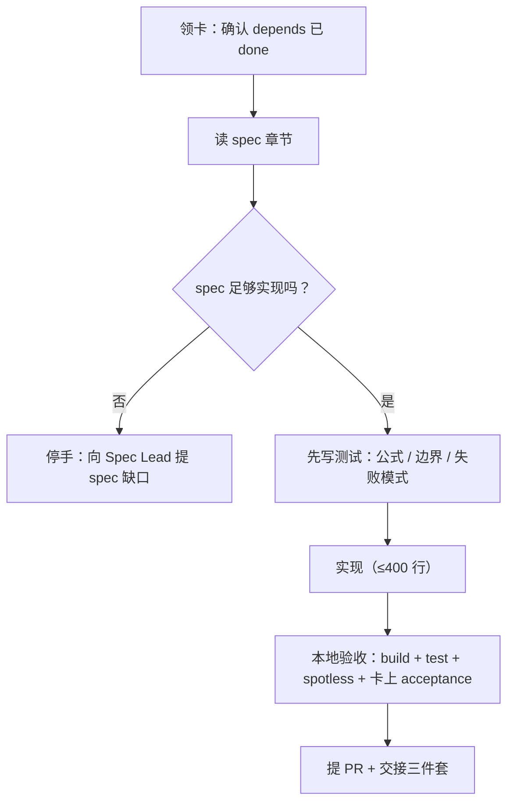

# Agent 重建指南（IndustrialCraft 2）

> 读者：参与 `rebuild/` 的所有 Agent（Orchestrator / Core / Platform / Content / Client / QA / Artist / Docs / Spec）
> 优先级：[`AGENTS.md`](./AGENTS.md)（硬约束）＞ [`decisions.md`](./decisions.md)（决策）＞ 任务卡 ＞ 本指南。本指南与前两者冲突时，以前两者为准，并报告 Orchestrator。
> 本文件**不含任何参考源码路径**，实现角色可以放心整篇加载。Spec 角色另读 Orchestrator 分发的 Spec 附录。

---

## 0. 开工前 60 秒

按顺序读：

1. 本文件 §1–§3
2. [`AGENTS.md`](./AGENTS.md)：角色、可读范围、文件所有权
3. [`decisions.md`](./decisions.md)：只看与你任务相关的行
4. 你的任务卡 `../plan/tasks/<ID>.yaml`
5. 任务卡 `spec:` 字段列出的 spec 文件（最多 2 个）

然后确认三件事。任意一件答不上来，**停手，问 Orchestrator**：

- 我的角色是什么？我能写哪些目录？
- 我依据的是哪几个 spec 章节？
- 验收命令是什么？

---

## 1. 项目一句话

把一个停更的工业模组按**行为规格净室重写**为 **IndustrialCraft 2**（mod id `ic2`），主基线 **NeoForge 1.21.1 / Java 21**，同步 **NeoForge 26.1.2 与 26.2 / Java 25**，作为开源项目发布。目标是核心行为一致（同样的输入、能耗、产出），**不要求 1:1 复刻**。

### 1.1 工作规则

| # | 红线 | 违反后果 |
|---|---|---|
| 1 | 实现角色只依据 `spec/` 工作，不读、不引用、不索要参考源码 | PR 拒收 |
| 2 | 注册、网络和资源使用 `ic2`，路径核对 2.9.40 基线 | 核对 A3 与注册规格 |
| 3 | 没有 spec 的行为不实现；spec 缺失或含糊 → 报 Spec Lead，不要猜 | 返工 |
| 4 | `common` 层不得 import `net.neoforged.*` 或任何版本专属 API | CI 失败 |
| 5 | 网络层不用反射序列化，不从网络数据加载类 | 安全门禁失败 |
| 6 | 只写自己所有权内的目录；跨目录先找 Orchestrator | PR 拒收 |
| 7 | 新逻辑必须有单测或 parity 场景；挂在本任务下的 decisions.md B 表修复项必须有回归测试 | PR 拒收 |
| 8 | 原版素材文件（贴图/模型/音效/GUI）**永不提交进本仓库**，只能放私有仓库 `ic2-legacy-assets`（decisions.md A22） | PR 拒收，需清洗历史 |
| 9 | 已定范围由 Orchestrator 直接推进，按既有门禁评审（A16） | 补齐交接或验收记录 |

### 1.2 已定案的项目事实（2026-11-20 更新）

| 项 | 结论 |
|---|---|
| 路线 | 净室重写，三角色隔离（A2） |
| 平台 | NeoForge 1.21.1 主基线；26.1.2 与 26.2 同步编译，各自运行验收从 P6 开始（A5） |
| 包名 / group | `com.industrialage.ia2` 为既有内部坐标（A3） |
| 协议 | 代码 LGPL-3.0（A11）；新作素材 CC BY-SA 4.0（A21） |
| 可见性 | GitHub 私有仓库（spectrum527 账号），素材全部重绘后才转 Public（A12） |
| 发布 | 转 Public 前只做邀请制封闭测试，不上 Modrinth / CurseForge（A13） |
| 对外表述 | IndustrialCraft 2（IC2），按 A15 使用 |
| 构建 | ModDevGradle（A19）；CI 为 GitHub Actions，看板为 GitHub Projects（A18） |
| 配置 | 只建 58 个活键，无旧键兼容层；只出迁移文档（A10） |
| 版本基线 | 修复正式版的玩家行为与修正优先；2.9.40 补未覆盖行为，2.8.222 用于交叉核对（A23）。实现只读独立行为规格。 |
| 首发范围 | 依修复版的生存路线交付，包含两类管各 8 种、两档泵盖、四档充电电池及八条实际产线。G5 是内部切片，G10 验整版（A27）。 |
| 工具链 | 主线与 common 用 JDK 21，26.1.2 / 26.2 模块用 JDK 25；NeoForge / ModDevGradle / Gradle 版本以 `docs/02-platform.md` 锁定值为准 |

---

## 2. 目录约定（规范解释）

```
rebuild/                     ← 未来的开源仓库根
├── AGENTS.md / decisions.md / AGENT-GUIDE.md
├── docs/                    ← 章程、平台、法律存档、balance 等（P0 起建）
├── spec/                    ← 行为规格（实现者唯一信息源）
│   ├── _schema/             ← 模板
│   └── <子系统>/            ← energy/ machines/ recipes/ registry/ heat/ ...
├── src/                     ← Gradle 多模块根
│   ├── common/              ← 加载器无关核心 + 内容定义
│   │   └── src/main/java/com/industrialage/ia2/{energy,machine,recipe,fluid,crop,reactor,worldgen,network,config,content,api,platform,lifecycle}/
│   ├── neoforge/            ← 平台适配（1.21.1、26.1.2、26.2 版本子模块及 26.x 共用 Java）
│   ├── datagen/             ← 数据生成
│   └── test/                ← JUnit + GameTest
├── parity/                  ← 场景脚本、期望值与对比报告（QA）
└── assets/                  ← 新作素材 + SOURCES.md 登记（原版素材不在这里）
```

仓库之外（私有，不随本仓库发布）：

- `../ic2-legacy-assets/`：原版素材私有仓库，Gradle 属性 `ic2.legacyAssetsDir` 引入，缺省可构建。
- `../reference-env/`：1.19.2 参考实例（ForgeGradle 开发环境 + 原 jar），QA 用来采集期望值。

- 任务卡里写的 `common/...`、`neoforge/...`、`test/...` **一律相对于 `rebuild/src/`**。
- 计划文档里出现的 `ic2-reforged/` 是旧名，等同于 `rebuild/`。
- 包根 `com.industrialage.ia2`（decisions.md A3，已定稿）。

---

## 3. 标准工作循环



### 3.1 完成定义（PR 描述模板）

```markdown
## 任务卡
P?-T?

## 依据的 spec 章节
- spec/<path>.md §<n>

## 做了什么
-

## 没做什么 / 已知缺口
-

## 怎么验证（贴命令与输出）
./gradlew build
./gradlew :common:test --tests ...

## decisions.md 关联修复项
- B#xx → 回归测试：<TestName>（无则写"无"）

## 下游依赖 / 交接
-
```

缺"spec 章节 / 验证输出 / 交接"任意一项，不合并。

---

## 4. 技术基线

| 领域 | 选择 | 禁止 |
|---|---|---|
| 注册 | `DeferredRegister`（只在 neoforge 层） | 静态字段即注册表、类加载期注册 |
| 平台抽象 | `Platform` → `RegistryFacade` / `EventFacade` / `NetworkFacade` / `CapabilityFacade` / `ClientFacade` / `ConfigFacade`，构造注入 | 60+ 方法的上帝接口、静态单例 |
| 配方 | `RecipeType` + `Recipe<T extends RecipeInput>` + `MapCodec` + `StreamCodec`，只走数据包 | 让机器配方伪装成 `Container` 配方 |
| 网络 | `CustomPacketPayload` + `StreamCodec`，长度/范围校验 | 反射类型标签序列化、`Class.forName` |
| 机器 tick | 显式组件 / 显式注册 tick 回调 | 反射扫描方法注解来订阅 tick |
| 能量网 | 同步计算 + 预留可插拔计算器接口（decisions.md B#6） | 假异步、两套能量网并存 |
| GUI | 一套数据驱动布局 + 手写例外通道（B#8） | 两套 GUI 体系并存 |
| 配置 | `ModConfigSpec`，只保留活键（A10），键名沿用 spec 中的活键清单 | 旧键兼容层、死键 |
| 内容 | 能用定义文件生成就不写类（机器/方块/掉落/语言键/JEI 分类） | 每台机器一个手写类 |
| 测试 | JUnit（公式、库存、配方、能量）+ NeoForge GameTest（方块/机器） | 只"看起来正确"的验收 |
| 日志 | SLF4J | `System.out` |
| 风格 | common / 1.21.1 用 Java 21，26.1.2 / 26.2 用 Java 25；4 空格、`final`/`record`/`sealed` 按宜使用、公开 API 有 javadoc、spotless | 无说明的 `@SuppressWarnings("unchecked")` |

常用命令（P2 骨架落地后可用）：

```bash
./gradlew build
./gradlew :neoforge:1.21.1:runClient
./gradlew :neoforge:1.21.1:runServer
./gradlew :datagen:runData
./gradlew :test:test
./gradlew :test:runGameTest
./gradlew spotlessCheck
```

---

## 5. 按角色速查

### Orchestrator

- `decisions.md` 唯一写入者；负责拆卡、排依赖、按门禁推进；按 A16 执行与评审。
- 当前可领 G2 之后的能量网、机器框架及可并行的规格和美术任务，见 §6。
- 写任务卡时：只引用 `spec/` 章节；每卡 ≤ 2 个 spec、≤ 5 个源码文件；`acceptance` 必须是可执行命令或可量化指标。
- 给实现角色派卡时，确保卡里、对话里不出现参考源码路径。
- G0 确认的 39 项用于内部基础切片。首发以 A27、设备清单与玩家专项为分母。

### Spec Lead / Spec Agent

- 产出 `spec/`。阅读范围、底稿位置和写作规则见 Orchestrator 分发的 **Spec 附录**（不在本仓库公开范围内）。
- spec 只写行为、数值（带单位）、公式、边界、失败模式；不写源码片段（> 5 行）、类名、混淆名、行号。
- decisions.md 标"修复"的条目，spec 写"重建行为 = 修复后"，并单列"原版 bug（用于回归）"。

### Core Agent（`src/common/{energy,machine,recipe,fluid,crop,reactor}/`）

- 核心层纯 Java + Minecraft 公共类型；平台能力通过 Facade 注入。
- 优先顺序：平台接口（P2-T2）→ 生命周期（P2-T4）→ 网络 payload（P2-T6）→ 能量网（P3）→ 机器框架（P4）。

### Platform Agent（`src/neoforge/`）

- P0-T4/P2-T1：**ModDevGradle** 多模块（A19），锁定 NeoForge 版本号写进 `gradle.properties`；支持可选属性 `ic2.legacyAssetsDir` 作为额外资源目录（缺省时跳过，A22），`rebuild/assets/` 同路径优先。
- 版本差异收敛于 neoforge 层；26.x 共用 Java 位于 `src/neoforge/26.x/src/main/java`；1.21.1 与 26.1.2 共用屏幕访问位于 `src/neoforge/pre-26.2/src/main/java`，26.2 屏幕访问与其他专属差异留在对应版本目录。`26.1.2` 分支的 PR 分别编译 1.21.1 与 26.1.2；`26.2` 集成分支的 PR 分别编译三个目标。26.1.2 与 26.2 分别从 P6 起运行验收。
- CI（GitHub Actions）加两条检查：`common` 下 grep `import net.neoforged` 必须为空；仓库内不得出现 legacy 素材（对照 `assets/SOURCES.md`）。
- 仓库根放 `LICENSE`（LGPL-3.0）与 `LICENSE-ASSETS`（CC BY-SA 4.0）。

### Content Agent（`src/common/content/`）

- 只填定义数据 + 少量特殊逻辑；数值全部来自 spec 参数卡。
- 注册 ID 一律 `ic2:<id>`；外部互通的标签用 `c:`（必要时加 `forge:`，如 B 表的蒸汽标签）。

### Client Agent（`src/client/`、`src/compat/`）

- GUI 走数据驱动布局；槽位坐标照 spec（布局属于功能需求，可照写）。
- JEI 分类随机器定义生成。

### QA Agent（`parity/`、`src/test/`）

- P1：parity 场景格式 + 采集脚本；相似度检查脚本（5-gram Jaccard：单文件 > 25% 失败、> 15% 警告、连续 8 行相同失败）。
- 容差：能量 ±1%；机器 ±1 tick / ±1%；配方精确；反应堆 ±2%；作物用统计检验；GUI 结构一致。
- 只看期望值，不看参考源码。
- P0-T5：在仓库外的 `../reference-env/` 搭 ForgeGradle 1.19.2 开发环境，把原 jar 作为 mod 加载，离线开发用户名运行；依赖按锁定工具链获取（A20）。该目录永不提交进本仓库。

### Artist / Audio Agent（`assets/`）

- 本仓库 `assets/` **只收新作**（CC BY-SA 4.0）。三类纹理从空白画布重绘，私有参考存放在独立仓库 `ic2-legacy-assets`，不进本仓库（A22）。
- 每个资源在 `assets/SOURCES.md` 登记状态 `legacy` / `new`、作者、协议；转 Public 的门禁是 `legacy` = 0（A7）。
- 新作署名及 CC BY-SA 4.0 登记见 `assets/SOURCES.md`。纹理路径、状态、制作与验收见 `spec/assets/textures.md`。

---

## 6. 当前工作（2026-11-19）

G0 与 G2 已通过。P2 的注册、生命周期、能力、配置、网络和物理客户端接线均已交付。[验收证据与机器接入入口](docs/gates/G2.md)

| 可开始的工作 | 输入 | 交付 |
|---|---|---|
| Core 与 QA 执行 P3-T1、P4-T1 | 能量规格、平台与生命周期契约 | 能量图与方块实体组件的独立实现及回归 |
| Spec 执行 P1-T2/T19 | 章程、路由实测与玩家路线 | 125 个设备/管件逐项映射、修复版工况和存盘期望 |
| Artist 执行 P8-T3 | 纹理规格和资产清单 | 机器样张、电池电量、线缆、两类管道端口/朝向及泵盖 |

G1、G5、机器 M09 回归、目标端物流与客户端美术仍待验收。P4-T9/P5-T9 交付运输切片，P6-T14 和 P10 负责原接线及候选复验。首发排期见私有计划仓库的 `task_plan.md`。

---

## 7. 必须停手上报的情况

- 任务与 `decisions.md` 冲突，或 spec 与 decisions 冲突。
- spec 缺少实现所需的数值、边界或失败模式。
- 需要修改所有权之外的目录。
- 发现自己的上下文里出现了参考源码路径或片段（实现角色）：停止，报告，丢弃相关产出。
- 需要新增第三方依赖或改变平台版本。
- 验收命令无法执行（环境缺失，例如没有 JDK）：报告阻塞，不要伪造输出。

---

## 8. 原版的已知坑（不要重蹈）

这些是架构层面的教训，实现时主动规避：

1. 平台差异集中在一个巨型代理接口 → 拆成小 Facade。
2. 网络序列化按类型标签反射还原 → 显式 `StreamCodec`。
3. 机器配方伪装成容器配方 → 用 `RecipeInput`。
4. tick 订阅靠反射扫描 → 显式注册。
5. 能量网"异步"其实是抛异常的空壳 → 同步实现，接口可插拔。
6. 两套 GUI 并存 → 一套数据驱动。
7. 配置里约三分之一的键没有任何读取者 → 只建活键。
8. 一批注册了但无法使用、或一放置就崩的内容 → 以 decisions.md B 表为准：修复、砍掉或重新设计，每个修复项都要有回归测试。
