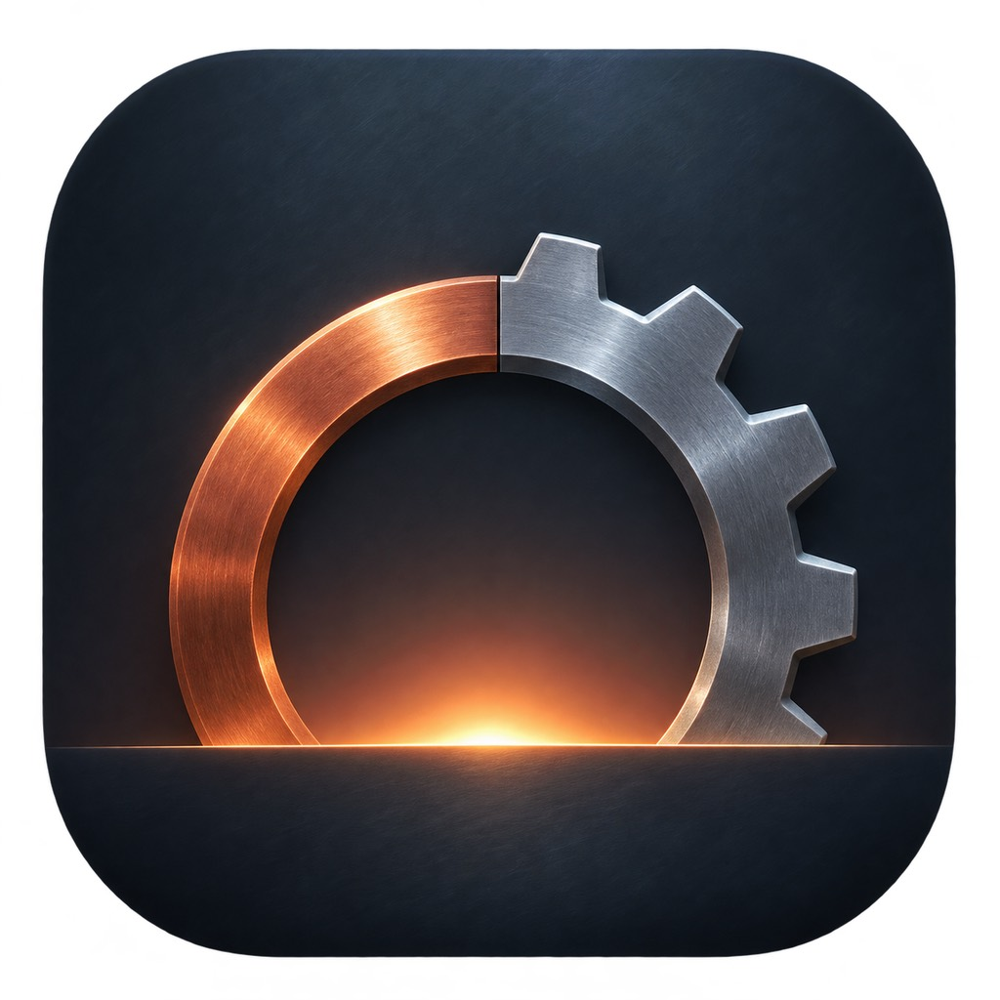
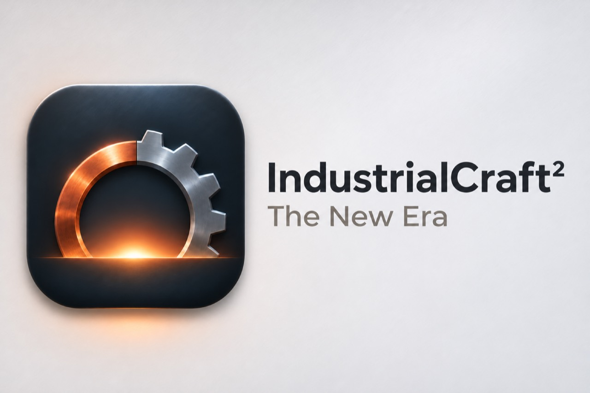

<h1> IndustrialCraft²: The New Era</h1>

[简体中文](README.md) · **English**



**IndustrialCraft²: The New Era** is an independent community reimplementation of IC2 Experimental gameplay.

## Download and install

**The current stable release is 1.0.6.** Pick the JAR for your Minecraft version and put it in the instance’s `mods/` directory. In multiplayer, install the same JAR on the client and the dedicated server. The original mod, the previous repair project and this rebuild all use the `ic2` ID. Give each its own instance. [Release notes](https://github.com/spectrum527/IndustrialCraft2-The-New-Era/releases/tag/v1.0.6) · [SHA-256 checksums](https://github.com/spectrum527/IndustrialCraft2-The-New-Era/releases/download/v1.0.6/SHA256SUMS.txt) · [1.0.6 source review](https://github.com/spectrum527/IndustrialCraft2-The-New-Era/releases/download/v1.0.6/SELF-REVIEW-1.0.6.md)

| Minecraft | Mod loader | Java | Download |
| --- | --- | ---: | --- |
| 1.19.2 | Forge 43.5.0 | 17 | [Forge 1.19.2 JAR](https://github.com/spectrum527/IndustrialCraft2-The-New-Era/releases/download/v1.0.6/ic2-forge-1.19.2-1.0.6.jar) |
| 1.21.1 | NeoForge 21.1.265 | 21 | [NeoForge 1.21.1 JAR](https://github.com/spectrum527/IndustrialCraft2-The-New-Era/releases/download/v1.0.6/ic2-neoforge-1.21.1-1.0.6.jar) |
| 26.1.2 | NeoForge 26.1.2.128 | 25 | [NeoForge 26.1.2 JAR](https://github.com/spectrum527/IndustrialCraft2-The-New-Era/releases/download/v1.0.6/ic2-neoforge-26.1.2-1.0.6.jar) |
| 26.2 | NeoForge 26.2.0.95 | 25 | [NeoForge 26.2 JAR](https://github.com/spectrum527/IndustrialCraft2-The-New-Era/releases/download/v1.0.6/ic2-neoforge-26.2-1.0.6.jar) |

Gameplay starts with your first machine and a coal-fired generator. To get rubber, look for rubber trees, a distinct tree added by the mod. See the player guide linked here, or check MC百科 (linked in the credits below) for more guidance. [Player guide and wiring examples](docs/first-playable.en.md)

Fit an extraction or injection nozzle to any item or fluid pipe. Use the button beside a machine GUI to configure automation on each face. Hoppers and pipes can supply ingredients and compatible batteries, then collect finished items from output or working slots. [Pipe nozzles and machine access](spec/logistics/nozzles-and-side-access.md)

The One Probe and Curios are optional. The One Probe shows the energy held in a machine and the contents of its tanks. Curios adds a back slot so you can wear a battery pack or electric jetpack on your back and charge it by standing on a charge pad of the matching tier. [Integration behavior and tests](spec/platform/optional-integrations.md)

## Source, artwork and authorization

The project implementation was rewritten entirely under clean-room principles. The specification team recorded observable inputs, outputs and edge cases. Developers and testers independently wrote the implementation and assertions from those specifications. Comparison with three reference codebases and review of the matches found no evidence of copied implementation code from the original mod or the repair project. The author redrew the game artwork. In-game variants include tints and equipment layers derived from those redraws. [First-release self-review signed by ChatGPT](docs/self-review-1.0.0.md) · [Asset credits](assets/SOURCES.md)

The project credits **MC百科 (mcmod.cn)** as the public reference for machine formulas and recipes. Its editors document machine parameters, processing conditions, ingredients and outputs. We wrote the implementation independently and checked version-specific behavior in running game instances. [MC百科’s IndustrialCraft² entry](https://www.mcmod.cn/class/2.html) · [Macerator recipes](https://www.mcmod.cn/item/241.html)

**The project has received no written authorization from the rights holders of the original IndustrialCraft².** Project source code is licensed under LGPL-3.0-only. The author’s redrawn game artwork is licensed under CC BY-SA 4.0. The author permits the icon and cover to be used solely to identify this project. [Rights notice](NOTICE.md) · [Code license](LICENSE) · [Game asset license](LICENSE-ASSETS) · [Brand terms](docs/branding.md)

## Contribute

The maintainers are committed to keeping the project **open source and non-profit**. Official builds are free to download. Pull requests are welcome. If you would like to maintain a port, contribute artwork, write documentation or help test the mod, you can apply to collaborate. When reporting a bug, include your Minecraft and loader versions, the steps to reproduce it and what happened. [Report an issue](https://github.com/spectrum527/IndustrialCraft2-The-New-Era/issues/new/choose) · [Open a pull request](https://github.com/spectrum527/IndustrialCraft2-The-New-Era/compare) · [Apply to collaborate](https://github.com/spectrum527/IndustrialCraft2-The-New-Era/issues/new?template=co-creation.yml)

The three NeoForge targets build from `main`. Forge 1.19.2 lives on the separate `1.19.2` branch. Run the matching command from the root of that branch. On Windows, use `gradlew.bat`. [NeoForge release source](https://github.com/spectrum527/IndustrialCraft2-The-New-Era/tree/v1.0.6) · [Forge release source](https://github.com/spectrum527/IndustrialCraft2-The-New-Era/tree/v1.0.6-forge-1.19.2)

```sh
# main — build the three NeoForge JARs
./gradlew :neoforge:1.21.1:jar :neoforge:26.1.2:jar :neoforge:26.2:jar

# 1.19.2 — build the reobfuscated Forge JAR
./gradlew :forge:1.19.2:reobfJar
```
