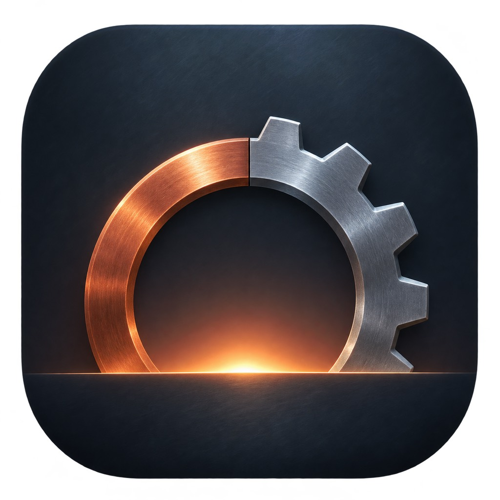
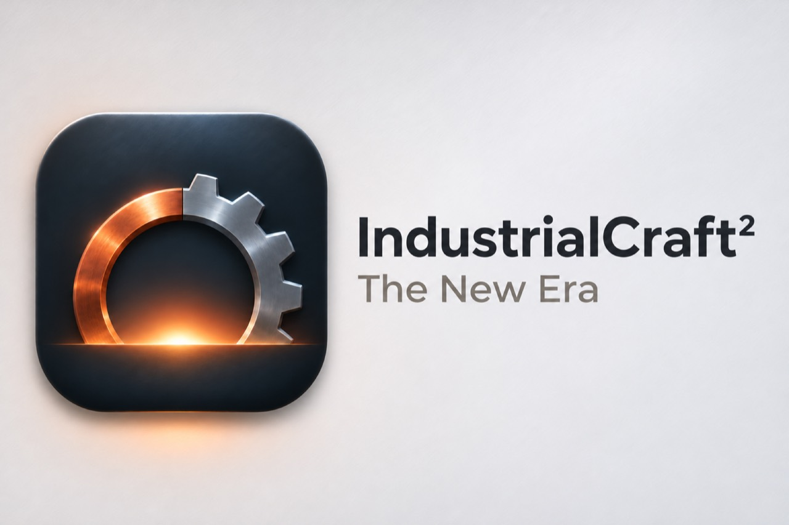

<h1> IndustrialCraft²: The New Era</h1>

**简体中文** · [English](README.en.md)



**IndustrialCraft²: The New Era (工业时代2:新纪元）** 是对 IC2 Experimental 玩法的独立社区重建。

## 下载与安装

**当前正式版为 1.0.1。** 按 Minecraft 版本选择下表中的一个 JAR，放入对应实例的 `mods/`。联机时客户端和专服安装同一份文件。原作、旧修复版与本项目共用 `ic2` 标识，请分别使用独立实例。 [发行说明](https://github.com/spectrum527/IndustrialCraft2-The-New-Era/releases/tag/v1.0.1) · [SHA-256 校验](https://github.com/spectrum527/IndustrialCraft2-The-New-Era/releases/download/v1.0.1/SHA256SUMS.txt)

| Minecraft | 加载器 | Java | 下载 |
| --- | --- | ---: | --- |
| 1.19.2 | Forge 43.5.0 | 17 | [Forge 1.19.2 JAR](https://github.com/spectrum527/IndustrialCraft2-The-New-Era/releases/download/v1.0.1/ic2-forge-1.19.2-1.0.1.jar) |
| 1.21.1 | NeoForge 21.1.265 | 21 | [NeoForge 1.21.1 JAR](https://github.com/spectrum527/IndustrialCraft2-The-New-Era/releases/download/v1.0.1/ic2-neoforge-1.21.1-1.0.1.jar) |
| 26.1.2 | NeoForge 26.1.2.128 | 25 | [NeoForge 26.1.2 JAR](https://github.com/spectrum527/IndustrialCraft2-The-New-Era/releases/download/v1.0.1/ic2-neoforge-26.1.2-1.0.1.jar) |
| 26.2 | NeoForge 26.2.0.95 | 25 | [NeoForge 26.2 JAR](https://github.com/spectrum527/IndustrialCraft2-The-New-Era/releases/download/v1.0.1/ic2-neoforge-26.2-1.0.1.jar) |

游玩的整体思路从第一台机器和火力发电机开始，如果需要取得橡胶，应该寻找一种特有的名为橡胶树的树木。玩家指南如下，也可去MC百科（链接见下方公开资料鸣谢）获取更多指引。 [玩家指南与接线示例](docs/first-playable.md)

The One Probe 和 Curios 均可按需安装。前者显示机器的实际电量和储罐液量，后者提供背饰栏，安装之后能把电池背包或电动喷气背包装在背饰位，也能站上对应等级的充电座为其充电。 [联动与实测](spec/platform/optional-integrations.md)

## 源码、美术与授权

本项目的实现完全按洁净室原则重写。规格人员记录可观察的输入、输出与边界，开发和测试人员据此独立编写实现和断言。对发布源码和三套参照的比对与逐项复核，未发现抄录原作或修复版实现代码的情形。项目的游戏美术由作者重绘，并以重绘稿制作染色、装备图层及其他游戏内变体。 [ChatGPT 署名的首发自审查报告](docs/self-review-1.0.0.md) · [逐项素材来源](assets/SOURCES.md)

机器公式和配方的公开资料来源为 **MC 百科（mcmod.cn）**。感谢百科编辑者整理机器参数、加工条件和投入产出。项目根据这些玩法资料独立实现，并用对应版本的运行结果复核具体数值。 [MC 百科 · 工业时代 2](https://www.mcmod.cn/class/2.html) · [打粉机配方条目](https://www.mcmod.cn/item/241.html)

**本项目尚未获得 IndustrialCraft² 原作权利方的书面授权。** 本项目代码采用 LGPL-3.0-only，作者重绘的游戏美术采用 CC BY-SA 4.0。作者提供的图标与封面仅供标识本项目。 [授权声明](NOTICE.md) · [代码许可](LICENSE) · [美术许可](LICENSE-ASSETS) · [品牌标识条款](docs/branding.md)

## 参与开发

维护团队承诺项目保持**开源、非营利**，官方构建免费下载。欢迎提交 PR，也欢迎就移植、美术、文档或测试申请共创。报告问题时请附上 Minecraft 和加载器版本、复现步骤及实际结果。 [提交问题](https://github.com/spectrum527/IndustrialCraft2-The-New-Era/issues/new/choose) · [提交 PR](https://github.com/spectrum527/IndustrialCraft2-The-New-Era/compare) · [申请共创](https://github.com/spectrum527/IndustrialCraft2-The-New-Era/issues/new?template=co-creation.yml)

NeoForge 三版从 `main` 构建，Forge 1.19.2 使用独立的 `1.19.2` 分支。下列命令在对应分支的仓库根目录运行。Windows 使用 `gradlew.bat`。 [NeoForge 发行源码](https://github.com/spectrum527/IndustrialCraft2-The-New-Era/tree/v1.0.1) · [Forge 发行源码](https://github.com/spectrum527/IndustrialCraft2-The-New-Era/tree/v1.0.1-forge-1.19.2)

```sh
# main，构建 NeoForge 三版
./gradlew :neoforge:1.21.1:jar :neoforge:26.1.2:jar :neoforge:26.2:jar

# 1.19.2，构建 Forge 重混淆发行包
./gradlew :forge:1.19.2:reobfJar
```
