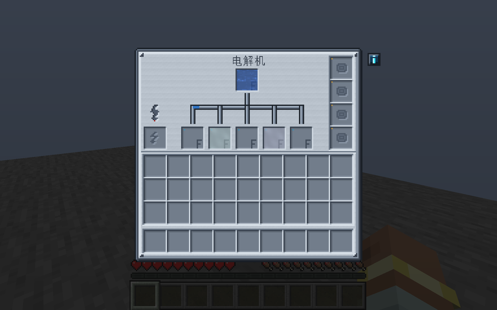
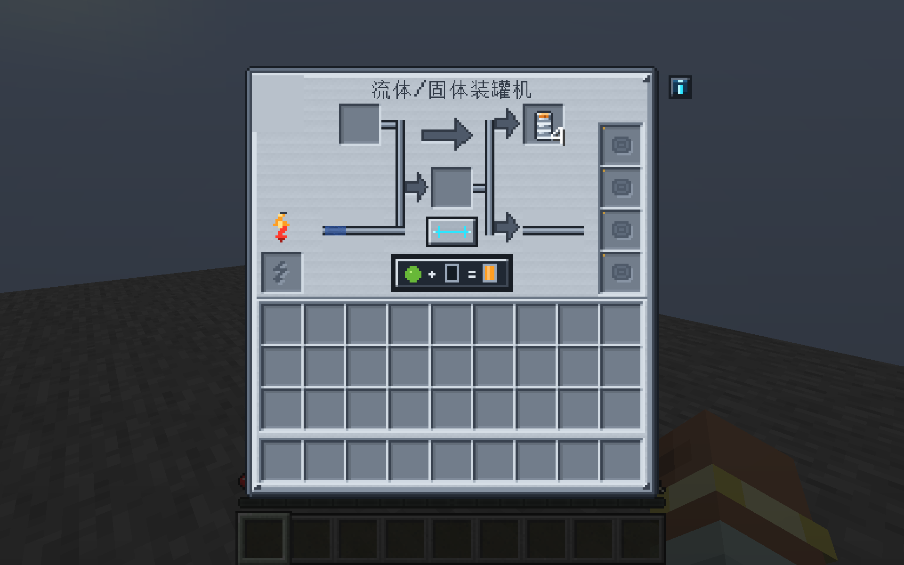
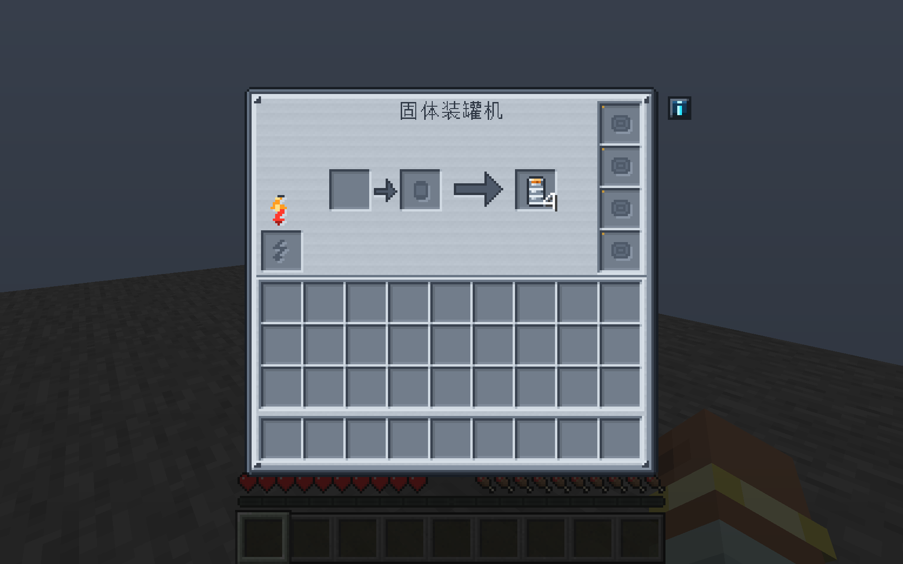

# 机器、储物箱与可选模组复验

NeoForge 1.21.1、26.1.2 和 26.2 的专服以实际 JAR 启动。客户端进入测试服操作菜单，核对作者绘制的槽位、实际投入与产出。表中记录本次候选的 SHA-256。 [机器读数、储物箱和安装组合](installed-results.json)

| Minecraft | 候选 JAR SHA-256 | 储物箱拆装 | 模组安装组合 |
| --- | --- | ---: | ---: |
| 1.21.1 | `3e00ece731ac57a54a862cd9749e1eeff97671589b91661e9b967e0ec96e341d` | 24 | 4 |
| 26.1.2 | `ac62f359428cba1c34daddf386e30160480306483c6498dcc5969abf54348cca` | 24 | 4 |
| 26.2 | `70b95b0149ed284e3e1c5a10ae77947e81969cce159334139df13858027ff169` | 24 | 4 |

## 电解机与装罐机

修复版 1.2.4 以 10,000 EU、40 mB 水开始，工作 20 刻后剩 9,360 EU，200 刻后剩 3,600 EU。候选在 2,560 EU 时停在 80/200 刻，补齐 3,840 EU 后产出。五路中的第二路为下方 26 mB 氢气，第四路为上方 13 mB 氧气，其余三路为空。四个升级槽接受流体拉入升级。复测包括从侧罐吸水、取回升级和拒绝超频升级。 [电解与装罐的行为规格](../../../spec/machines/electrolyzer-and-canners.md)

拿 0.1.0 格式的存档冷启动，机器原有 31 刻、已付 496 EU。断水停机后用第二个专服进程重开同一世界，补水后另付 5,904 EU，产气一批。满电 32,000 EU 与恰有 5,904 EU 两种起始状态的余量分别为 26,096 EU 和 0 EU。

流体/固体装罐机从左上接收容器、中央接收添加剂、右侧取成品。封装、灌液、排空、富集四种模式均实作。一个苹果加四个空锡罐得到四个罐头，富集产出的通用流体单元实含 1,000 mB 生物质。固体装罐机使用自己画面的槽位，也取出了四个罐头。

以下三张是 1.21.1 简体中文客户端在最终候选中保存的原始截图。

## 储物箱和装备

六种箱体各以空手、错误的铲、对应材质的正确工具和扳手拆回。木箱用斧，金属箱用镐。每轮验取回唯一箱体、重新放置和槽位内容，含数量、位置及带命名和耐久的物品。私人箱另验在重放后维持所有者和访问限制。原生生存破坏、拾取与放置均发生在已安装的游戏进程中。

每版分别以 IC2 单装、加 The One Probe、加 Curios、两者同装启动。探针读出水 1,234 / 24,000 mB，并读回使用前后的储电量。Curios 的背饰格接受五种背包。充电座单次将电池背包从 0 充至 100 EU，座内从 701 降至 601 EU，取下背包后电量保留。燃油喷气背包使用燃料。 [可选模组规格及复测范围](../../../spec/platform/optional-integrations.md)

## 读数、视口和动力

在 1,920×1,200、自动 5 倍的实际客户端中，核堆三视图、分拣机两页和区块加载器均收在 240 逻辑像素高的窗口内，作者画面高 236，顶底各留 2 像素。UU 扫描机能读全 3,300 刻，物质机和手摇动能机读数、蒸汽机热量及高级流体分配机的标题与状态分别核过画面。

磁化机在正常速度下抬升穿铁靴的生存玩家，空脚或断电时停留原位。三版都在 1 至 5 倍 GUI 比例下从客户端点中区块加载器底行，并从服务端读回选区。 [磁化机专项的客户端和服务端采样](movement.json) · [源码独立性逐项复核](../gameplay-compat-originality/README.md)
